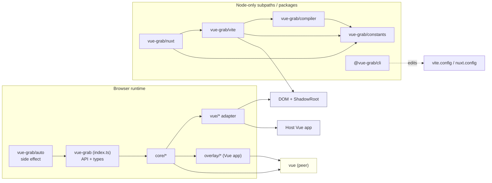
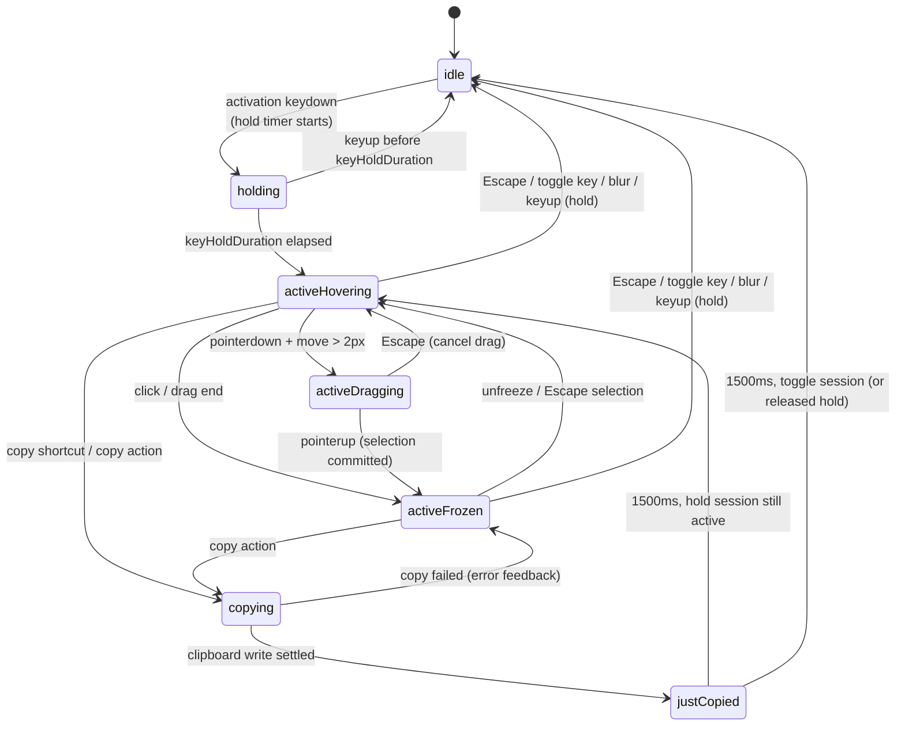
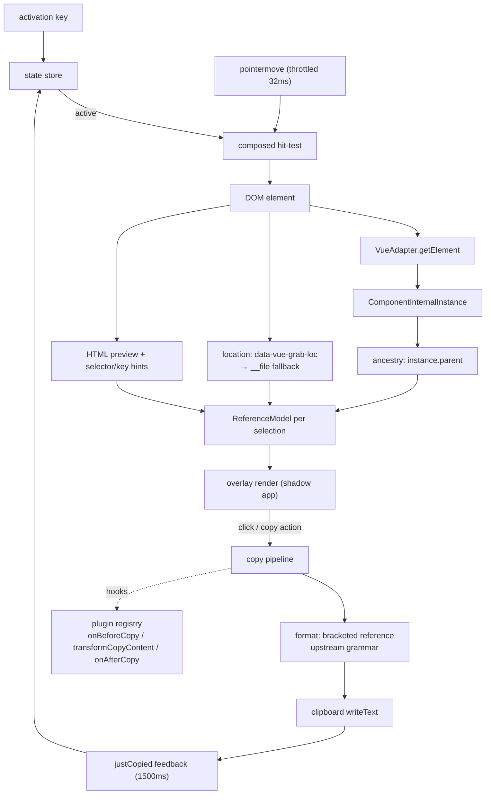
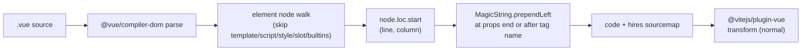
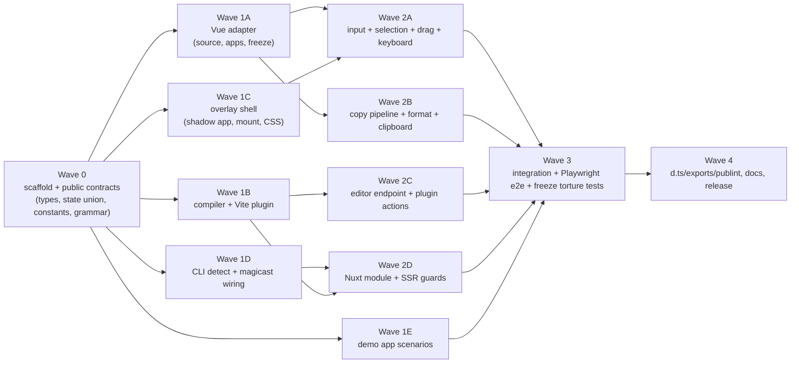

# Architecture Research

**Domain:** Vue 3.5+ dev-only inspection overlay (browser runtime + compile-time Vite plugin + installer CLI), port of React Grab
**Researched:** 2026-10-20
**Confidence:** HIGH for Vue internals and package/plugin mechanics (verified against `vuejs/core` v3.5.34 source, `@vitejs/plugin-vue` 6.0.10 dist, and the upstream `react-grab` 0.2.0 source); MEDIUM for long-term Vue 3.6/Vapor compatibility (3.6 is still RC).

## Decisions at a Glance

| Area | Decision | Why |
|------|----------|-----|
| Overlay UI | Separate Vue `createApp` mounted in an open Shadow DOM, with its own effect scope | Reuses the host's `vue` peer (no new framework), isolates CSS/events, and stays unfrozen because only host instances are paused |
| Vue adapter | Thin, isolated module behind a `VueAdapter` interface | `__vueParentComponent`/`__vnode` and `app._instance` are dev-only; `__vue_app__` is always set but useless without `_instance`; one seam to patch when Vue changes |
| Element location | Compile-time `data-vue-grab-loc="relpath:line:col"` injected by an `enforce: 'pre'` Vite transform (raw SFC AST + MagicString) | Only path that yields exact template line/column; `__file` alone has no position |
| Component usage location | `data-vue-grab-call="relpath:line:col"` injected on component tags, used only as an ancestry hint | Fallthrough attrs recover the parent's call site for most components without misattributing the element's own source |
| Freeze | `EffectScope.pause()` on every mounted component instance discovered by an instance-graph walk | Component scopes are always `detached`, so pausing the root scope does nothing; a full walk is required |
| Interaction capture | Always-mounted shadow host; `pointer-events` enabled only while active; full-viewport shield + composed hit-testing | No page-level `pointer-events` stylesheet, no scroll hijack, no click leakage to the host app |
| Packaging | One runtime package (`vue-grab`) with Node-only subpaths `./vite`, `./compiler`, `./nuxt`, `./constants`; separate `@vue-grab/cli` (the only package with a `bin`) | One install for runtime + plugin, version-locked attribute contract, browser entry stays dependency-light, CLI stays out of every install |
| Build | Vite 8 lib mode: browser ESM + separate IIFE pass, a Node pass (`target: 'node22'`) for subpaths, and a Vite lib pass for the CLI; `vite-plugin-dts` for `.d.ts` | One bundler family; `.vue` SFC compilation requires Vite + `@vitejs/plugin-vue`; no second toolchain |
| CLI config edits | `magicast` + `magicast/helpers` (`addVitePlugin`, `addNuxtModule`) | Format-preserving AST edits instead of regex patching |
| Tests | Vitest + jsdom for units/component, Playwright for the real overlay | jsdom is Vue Test Utils' compatibility baseline; layout/Shadow DOM/clipboard need a real browser |

## Standard Architecture

### System Overview

```
┌────────────────────────────────────────────────────────────────────────────┐
│ TOOLING (Node, dev only)                                                    │
│  ┌────────────────────┐  ┌─────────────────────┐  ┌──────────────────────┐  │
│  │ vite plugin         │  │ Nuxt module          │  │ vue-grab CLI         │  │
│  │ SFC loc injection   │  │ addVitePlugin +      │  │ detect, install,     │  │
│  │ virtual client      │  │ client-only plugin   │  │ magicast config edit │  │
│  │ /__vue-grab/open    │  │ /__vue-grab/open     │  │ options persistence  │  │
│  └─────────┬──────────┘  └──────────┬───────────┘  └──────────┬───────────┘  │
└────────────┼─────────────────────────┼─────────────────────────┼─────────────┘
             │ compile-time attrs      │ client import           │ package.json
             ▼                         ▼                         ▼
┌────────────────────────────────────────────────────────────────────────────┐
│ RUNTIME (`vue-grab`, browser, dev bundle only)                              │
│  ┌─────────────────┐   ┌──────────────────┐   ┌──────────────────────────┐  │
│  │ Input layer      │   │ Resolution layer │   │ Freeze controller        │  │
│  │ keys, pointer,   │──▶│ hit-test → el →  │──▶│ Vue scopes + CSS/WAAPI   │  │
│  │ drag, focus      │   │ Vue adapter      │   │ + pinned pseudo-states   │  │
│  └────────┬────────┘   └────────┬─────────┘   └────────────┬─────────────┘  │
│           │                     │                          │                │
│           ▼                     ▼                          ▼                │
│  ┌──────────────────────────────────────────────────────────────────────┐   │
│  │ State store (idle / holding / active{phase} / copying / justCopied)  │   │
│  └───────────────┬──────────────────────────────────────┬───────────────┘   │
│                  │                                      │                   │
│                  ▼                                      ▼                   │
│  ┌───────────────────────────────┐        ┌───────────────────────────────┐  │
│  │ Copy pipeline                 │        │ Plugin registry               │  │
│  │ format → clipboard → feedback │        │ copy / comment / open + hooks │  │
│  └───────────────────────────────┘        └───────────────────────────────┘  │
│                  │                                                           │
│                  ▼                                                           │
│  ┌──────────────────────────────────────────────────────────────────────┐   │
│  │ Overlay app (separate createApp, Shadow DOM, own EffectScope)        │   │
│  │ highlight boxes · label · toolbar · hierarchy menu · prompt · toast  │   │
│  └──────────────────────────────────────────────────────────────────────┘   │
└────────────────────────────────────────────────────────────────────────────┘
             │ reads (never mutates, except freeze/pin/restore)
             ▼
┌────────────────────────────────────────────────────────────────────────────┐
│ HOST VUE APP(S)                                                             │
│  DOM elements with __vueParentComponent / __vnode · component instances ·  │
│  app._instance · EffectScopes · Teleport / Suspense / KeepAlive subtrees   │
└────────────────────────────────────────────────────────────────────────────┘
```

The runtime is **read-mostly**: it observes the host DOM and Vue instance graph, temporarily pauses scopes and animations, and writes only to a shadow-root overlay plus reversible freeze artifacts (inline styles, a scoped stylesheet, paused animations). It never renders host components and never mutates host reactive state.

### Component Responsibilities

| Component | Responsibility | Typical Implementation |
|-----------|----------------|------------------------|
| `src/index.ts` | Side-effect-free public API: `init`, `VueGrabAPI`, plugin/types re-exports | Pure ESM module; no DOM at import time |
| `src/auto.ts` | Side-effectful bootstrap: read `window.__VUE_GRAB_CONFIG__`, call `init`, HMR dispose | Imported by the virtual client module and manual installs |
| `core/state.ts` | Single source of truth for the grab state machine and selection store | Discriminated union in `shallowReactive`/`ref`s; no Pinia |
| `core/events.ts` | Document/window listener lifecycle, activation key parsing, throttled pointer handling, drag gesture | Capture-phase listeners with an explicit `dispose()` |
| `core/hit-test.ts` | Coordinates → deepest element, piercing open shadow roots and same-origin iframes; skips overlay host | `elementsFromPoint` + composed-root recursion |
| `core/freeze.ts` | Ref-counted freeze session: nested layers for Vue reactivity, animations, pseudo-states; always restores | `try/finally`, snapshot/restore maps, `document.getAnimations()` |
| `vue/apps.ts` | Discover mounted Vue apps; walk instances through fragments/Teleport/Suspense/KeepAlive | `__vue_app__` scan + vnode graph traversal, `WeakSet` cycle guard |
| `vue/source.ts` | Element → instance → ancestry → `SourceInfo`; compile-time attr parsing with `__file` fallback | `VueAdapter` implementation |
| `vue/freeze.ts` | Pause/resume host component `EffectScope`s, excluding the overlay app | Instance walk → `scope.pause()` / `scope.resume()` |
| `core/copy.ts` | Debounced/abortable copy flow and clipboard write | Async pipeline with `AbortController`; `navigator.clipboard` + fallback |
| `core/format.ts` | HTML preview, ancestry lines, selector/key hints; exact upstream-compatible grammar | Pure functions, heavily unit tested |
| `core/plugin-registry.ts` | Merge plugin/theme/option contributions; dispatch hooks; error isolation | `Map<string, Plugin>`, hook dispatch with per-hook try/catch |
| `overlay/app.ts` | Create/destroy the separate Vue app in an open shadow root; inject inlined CSS | `createApp` + `app.mount` on a shadow container |
| `overlay/*.vue` | Highlight/label/toolbar/menu/prompt/toast UI | SFCs, `<script setup lang="ts">`, shadow-scoped CSS |
| `vite/index.ts` | Vite plugin: config capture, SFC transform, virtual modules, client HTML injection, editor endpoint | `apply: 'serve'`, `enforce: 'pre'` |
| `compiler/index.ts` | Framework-agnostic SFC/template transform (`vueGrabNodeTransform`, `transformSFC`) | `@vue/compiler-dom` parse/transform + `magic-string` |
| `nuxt/index.ts` | Nuxt module: Vite plugin + client-only plugin template + Nitro dev handler | `defineNuxtModule`, `addVitePlugin`, `addPluginTemplate`, `addServerHandler` |
| `packages/cli` | Detect project/PM, install runtime, wire config, persist options, remove | `commander`, `@clack/prompts`, `tinyexec`, `magicast` |

### Package / Module Dependency Graph



`@vue-grab/cli` has no compile-time dependency on runtime internals; the only shared contract is the package name and the plugin entry path it writes into config files. `vue-grab/constants` is the single source of truth for attribute names, virtual module IDs, and config global names.

## Recommended Project Structure

```
vue-grab/
├── package.json                       # private root; scripts delegate to pnpm -r
├── pnpm-workspace.yaml                # packages/*, apps/*; onlyBuiltDependencies
├── pnpm-lock.yaml
├── tsconfig.base.json                 # strict, bundler resolution, ES2022 lib
├── eslint.config.js                   # flat config: js, typescript-eslint, vue
├── .prettierrc.json
├── e2e/                               # Playwright specs + fixtures against apps/demo
│   ├── playwright.config.ts
│   └── specs/{activation,hover,copy,freeze,teleport,suspense,keep-alive,multi-app}.spec.ts
├── packages/
│   ├── vue-grab/
│   │   ├── package.json               # exports map, peerDeps: vue >=3.5
│   │   ├── vite.config.ts             # ESM browser build + separate IIFE build, dts
│   │   ├── vite.node.config.ts        # node22 build: vite/compiler/nuxt entries
│   │   ├── src/
│   │   │   ├── index.ts               # public API, no side effects
│   │   │   ├── auto.ts                # bootstrap + HMR dispose
│   │   │   ├── constants.ts           # attr names, virtual IDs, defaults, timings
│   │   │   ├── types.ts               # public option/state/plugin/API types
│   │   │   ├── core/
│   │   │   │   ├── init.ts            # single-instance init/dispose lifecycle
│   │   │   │   ├── state.ts           # GrabState union + store + actions
│   │   │   │   ├── events.ts          # activation keys, pointer/drag, teardown
│   │   │   │   ├── hit-test.ts        # composed hit-testing
│   │   │   │   ├── freeze.ts          # freeze session coordinator
│   │   │   │   ├── animations.ts      # CSS/WAAPI freeze
│   │   │   │   ├── pseudo-states.ts   # hover/focus snapshot + restore
│   │   │   │   ├── copy.ts            # copy flow
│   │   │   │   ├── format.ts          # preview + grammar
│   │   │   │   ├── selector.ts        # CSS selector + list key hints
│   │   │   │   ├── clipboard.ts       # writeText + execCommand fallback
│   │   │   │   ├── editor-client.ts   # POST /__vue-grab/open
│   │   │   │   ├── plugin-registry.ts
│   │   │   │   └── plugins/{copy,comment,open}.ts
│   │   │   ├── vue/
│   │   │   │   ├── adapter.ts         # VueAdapter interface + factory
│   │   │   │   ├── apps.ts            # app discovery + instance graph walk
│   │   │   │   ├── source.ts          # loc attrs + __file fallback
│   │   │   │   ├── freeze.ts          # scope pause/resume
│   │   │   │   └── internal.ts        # dev-only type augmentations
│   │   │   ├── overlay/
│   │   │   │   ├── app.ts             # createApp + shadow root + CSS injection
│   │   │   │   ├── Overlay.vue
│   │   │   │   ├── components/{HighlightBox,SelectionLabel,Toolbar,HierarchyMenu,
│   │   │   │   │                ContextMenu,PromptInput,Toast}.vue
│   │   │   │   └── styles.css         # imported with ?inline
│   │   │   ├── vite/
│   │   │   │   ├── index.ts           # plugin hooks
│   │   │   │   ├── virtual.ts         # virtual module ids/resolution
│   │   │   │   └── open-handler.ts    # dev middleware → launch-editor
│   │   │   ├── compiler/
│   │   │   │   ├── index.ts           # transformSFC / transformTemplate
│   │   │   │   └── inject.ts          # AST walk + MagicString edits
│   │   │   └── nuxt/
│   │   │       └── index.ts           # defineNuxtModule + addPluginTemplate
│   │   └── test/
│   │       ├── unit/{state,format,selector,freeze,adapter}.test.ts
│   │       ├── compiler/{inject,sourcemap,idempotency}.test.ts
│   │       └── fixtures/{components,sfc}/
│   └── cli/
│       ├── package.json               # @vue-grab/cli, bin: { vue-grab: ./dist/cli.js }
│       ├── vite.config.ts             # node22 lib build, ESM, shebang banner
│       ├── src/
│       │   ├── cli.ts                 # commander program
│       │   ├── commands/{init,configure,remove}.ts
│       │   ├── utils/{detect,install,wire,logger,non-interactive}.ts
│       │   └── templates/{vite,nuxt}.ts
│       └── test/{detect,wire,fixtures}/
└── apps/
    └── demo/
        ├── package.json
        ├── vite.config.ts             # vue() + vueGrab()
        ├── index.html
        └── src/
            ├── main.ts
            ├── App.vue                # nav between scenarios
            ├── components/            # nested component tree, list, form, animation
            ├── scenarios/{TeleportModal,SuspensePanel,KeepAliveTabs,SecondApp,ShadowWidget}.vue
            └── embedded/iframe.html   # same-origin iframe target
```

### Structure Rationale

- **`core/` vs `vue/`:** the interaction, state, formatting, and freeze-session logic is framework-agnostic; only `vue/` reads Vue internals. This is what makes a future adapter (or a stricter Vue-version guard) a local change rather than a rewrite.
- **`overlay/` is a real Vue app, not host-app components:** it owns its `createApp`, effect scope, and shadow root, which is the cleanest way to guarantee the overlay never freezes with the host.
- **`vite/` and `compiler/` are separate entries:** `compiler/` has no Vite dependency, so `vue-loader`/Webpack users (documented manual path) can reuse the exact same transform; `vite/` only adds virtual modules, HTML injection, and the editor endpoint.
- **`constants.ts` is exported:** compile-time and runtime code must agree on `data-vue-grab-loc`, `data-vue-grab-call`, and `window.__VUE_GRAB_CONFIG__`. One imported constant (bundled into both builds) prevents drift.
- **`packages/cli` stays independent:** the CLI only edits config files; it must not import the runtime or Vue. It owns the `vue-grab` bin and is run via `pnpm dlx @vue-grab/cli init` (or as a project devDependency); the runtime package ships no bin and no CLI dependencies.
- **`e2e/` at the root:** Playwright drives the demo app, not a package, so the suite exercises the real Vite plugin → runtime → clipboard path.

## Vue Adapter Contract

The adapter is the only code allowed to touch Vue internals. It is a plain object, injectable into `init()` for tests.

```ts
// src/vue/adapter.ts
import type { ComponentInternalInstance, VNode } from 'vue'

export interface VueSourceLocation {
  filePath: string          // project-relative, POSIX separators
  absolutePath: string | null
  lineNumber: number | null // 1-based
  columnNumber: number | null
  strategy: 'attr' | 'file' | 'none'
}

export interface VueComponentNode {
  componentName: string | null
  filePath: string | null
  lineNumber: number | null
  columnNumber: number | null
  element: Element | null
}

export interface VueAdapter {
  getInstance(element: Element): ComponentInternalInstance | null
  getAncestry(instance: ComponentInternalInstance): VueComponentNode[]
  resolveSource(element: Element, instance: ComponentInternalInstance | null): VueSourceLocation | null
  collectApps(): ComponentInternalInstance[]     // root instances, overlay excluded
  pause(apps: ComponentInternalInstance[]): () => void
}
```

Internal fields are read through a single `internal.ts` augmentation:

```ts
// src/vue/internal.ts
import type { ComponentInternalInstance, VNode } from 'vue'

export type VueHostElement = Element & {
  __vueParentComponent?: ComponentInternalInstance
  __vnode?: VNode
}

export type VueAppInternal = {
  _instance: ComponentInternalInstance | null
  _container: Element | null
}

export type VueComponentTypeInternal = {
  __file?: string
  __name?: string
  __vueGrabOverlay?: boolean   // our marker on the overlay root component type
}

export type VueInstanceInternal = ComponentInternalInstance & {
  __v_cache?: Map<PropertyKey, VNode>   // KeepAlive
}
```

### 1. Element → instance

`renderer.ts` sets both fields on every element it mounts, under `if (__DEV__ || __FEATURE_PROD_DEVTOOLS__)`:

```ts
if (__DEV__ || __FEATURE_PROD_DEVTOOLS__) {
  def(el, '__vnode', vnode, true)
  def(el, '__vueParentComponent', parentComponent, true)
}
```

Resolution walks the **composed** ancestor chain (parent elements, `shadowRoot.host`, and same-origin iframe boundaries) until it finds the first element with `__vueParentComponent`:

```ts
export function getInstanceFromElement(element: Element): ComponentInternalInstance | null {
  let current: Element | null = element
  while (current) {
    const instance = (current as VueHostElement).__vueParentComponent
    if (instance) return instance
    current = getComposedParent(current) // parentElement || shadowRoot.host
  }
  return null
}
```

Notes that must be encoded in the implementation and in tests:

- The fields are non-enumerable, writable, and **dev-only**. When Vue is loaded from a production build (`__DEV__ === false`, no `__FEATURE_PROD_DEVTOOLS__`), the adapter must return `null`, and the copy pipeline must degrade to DOM-only context (preview + selector) with a one-time console warning.
- Text nodes have no instance; start from the element.
- SVG/MathML elements are elements too; the adapter is namespace-agnostic.
- `__vnode` is the *host* vnode; `__vnode.el === element` in normal cases. Use `__vueParentComponent` for identity, not `__vnode`, because `__vnode` is re-assigned on patch (`el.__vnode = n2`, `traverseStaticChildren`).
- The instance returned is the component that owns the render function producing the element, **not** necessarily the component with a matching `__file` (a functional wrapper may produce nodes for its caller). Name/ancestry come from `instance.type`.
- Shadow DOM is crossed via `getRootNode().host`; same-origin iframe documents are crossed by the **hit-tester** (which translates coordinates and calls into the iframe document) and by app discovery. Do not walk `iframe.contentDocument` inside `getComposedParent`, because a host element has no parent link into its iframe's document.

### 2. Instance → ancestor stack

`instance.parent` is the component-owner chain and is what the copied context should show. It is not the DOM parent chain, so Teleport, portals, and slots produce the semantically correct ancestry.

```ts
export function getAncestry(instance: ComponentInternalInstance): VueComponentNode[] {
  const nodes: VueComponentNode[] = []
  const seen = new Set<ComponentInternalInstance>()
  for (let current: ComponentInternalInstance | null = instance; current; current = current.parent) {
    if (seen.has(current)) break
    seen.add(current)
    if (isOverlayInstance(current)) continue
    if (isBuiltinWrapper(current)) continue
    nodes.push({
      componentName: getComponentName(current.type as object, true) || null,
      filePath: normalizeFilePath((current.type as { __file?: string }).__file),
      lineNumber: null,
      columnNumber: null,
      element: current.vnode?.el instanceof Element ? current.vnode.el : null,
    })
  }
  return dedupeAdjacentByName(nodes)
}
```

The line/column fields start as `null` because `instance.type` carries no position. Enrich them after the walk: for each ancestor node `i > 0`, read `data-vue-grab-call` from the *previous* (child) node's root element — that attribute was emitted at the parent's usage of the child — and, only when its path equals the ancestor's `filePath`, copy the line/column into that ancestor node. This is why the two attributes have different names; a single attribute would misattribute the child's template location to the parent.

Name resolution mirrors Vue's own `getComponentName`: `displayName || name || __name`, then the basename of `__file` (`formatComponentName` does the same fallback). `__name` is emitted by `compileScript` for `<script setup>` (`__name: 'Foo'`). Do not invent names from the filename when `__file` already yields one; do use the basename as the last resort, matching Vue's devtools output.

Filter built-ins by flags, not by name strings: `__isSuspense`, `__isTeleport`, `__isKeepAlive`, and the transition wrappers (`BaseTransition`, `Transition`, `TransitionGroup`). They carry no useful source and only add noise. Keep `App`/root if it has a name or file.

### 3. Source location resolution

Precedence, highest first:

1. **`data-vue-grab-loc` on the element or a composed ancestor owned by the same instance.** Injected at compile time as `relpath:line:column` (path relative to the Vite `root`, POSIX separators, 1-based line/column). The value is parsed from the right so paths containing `:` still work: `/^(.*):(\d+):(\d+)$/`.
2. **`data-vue-grab-call` for ancestry enrichment.** Injected on component tags. Vue's attribute fallthrough places it on the child's rendered root; it is used only to fill the line/column of the ancestor entry whose `__file` matches the attribute's path. Never use it as the selected element's own location. Components with `inheritAttrs: false`, fragments, or multi-root templates silently drop it — that is an accepted degradation.
3. **`instance.type.__file`** for component identity and file path, with `lineNumber`/`columnNumber` = `null`. Vite's `@vitejs/plugin-vue` attaches `__file` in dev (`transformMain` adds `__file` when `devServer && !isProduction`), and `__file` is an absolute path in dev.
4. **No instance**: return `null`; the copy path falls back to a DOM-only reference (preview + selector + `key` hint).

The "same instance" constraint matters: when walking up the DOM you must stop climbing for `data-vue-grab-loc` as soon as `el.__vueParentComponent` changes. Otherwise a wrapper's ancestor attribute can be attributed to an inner element.

```ts
export function resolveElementLocation(element: Element, instance: ComponentInternalInstance | null) {
  if (!instance) return null
  let current: Element | null = element
  // Only accept attributes owned by the same component instance.
  while (current && (current as VueHostElement).__vueParentComponent === instance) {
    const attr = current.getAttribute(LOC_ATTR)
    if (attr) return { ...parseLoc(attr), strategy: 'attr' as const }
    current = getComposedParent(current)
  }
  const file = (instance.type as { __file?: string } | undefined)?.__file
  return file
    ? { filePath: normalizeFilePath(file), lineNumber: null, columnNumber: null, strategy: 'file' as const }
    : null
}
```

Absolute paths for the editor are recovered from `__file` when available; otherwise the plugin's `root` (delivered in `window.__VUE_GRAB_CONFIG__`) is joined with the relative attribute path. Path validation happens server-side in the editor endpoint, never in the browser.

### 4. Freeze: per-instance `EffectScope.pause()`

Verified in `vuejs/core` v3.5.34:

- Every component instance owns `instance.scope = new EffectScope(true /* detached */)` (`component.ts`).
- The render effect is created inside that scope: `instance.scope.on(); new ReactiveEffect(componentUpdateFn); instance.scope.off()` (`renderer.ts`).
- Because scopes are detached, **child component scopes are not children of the parent scope**. Pausing `app._instance.scope` freezes only the root component.
- `EffectScope.pause()` pauses the scope and all of its (non-detached) child scopes/effects; `resume()` un-pauses and re-triggers effects that were triggered while paused (`effect.trigger()` adds to `pausedQueueEffects` when `PAUSED`).
- On resume, the render effect's scheduler queues a normal job, so the UI catches up with the latest state in one flush.

Therefore the freeze walk must enumerate **all mounted component instances** and pause each instance's scope.

```ts
export function pauseInstances(roots: ComponentInternalInstance[]): () => void {
  const scopes = new Set<EffectScope>()
  for (const root of roots) {
    for (const instance of walkInstances(root)) {
      if (isOverlayInstance(instance)) continue
      if (instance.scope && !scopes.has(instance.scope)) scopes.add(instance.scope)
    }
  }
  scopes.forEach((scope) => scope.pause())
  return () => scopes.forEach((scope) => scope.resume())
}
```

Ownership detail: `EffectScope` has no public "is paused" getter, so a scope that was already paused by another consumer would be resumed incorrectly. Record `(scope as { _isPaused?: boolean })._isPaused` before pausing (available in dev builds), resume only scopes this session paused, and keep a session id so overlapping freeze/unfreeze calls cannot cross-resume.

The instance walk must cover every vnode shape, not just `instance.subTree.component`:

```ts
function walkInstances(root: ComponentInternalInstance): Set<ComponentInternalInstance> {
  const instances = new Set<ComponentInternalInstance>()
  const visitedVNodes = new Set<VNode>()

  const visitInstance = (instance: ComponentInternalInstance | null | undefined): void => {
    if (!instance || instances.has(instance)) return
    instances.add(instance)
    visitVNode(instance.subTree)
    const cache = (instance as VueInstanceInternal).__v_cache       // KeepAlive cache
    if (cache) for (const vnode of cache.values()) visitVNode(vnode)
  }

  const visitVNode = (vnode: VNode | null | undefined): void => {
    if (!vnode || visitedVNodes.has(vnode)) return
    visitedVNodes.add(vnode)
    if (vnode.component) visitInstance(vnode.component)

    const suspenseVNode = vnode as VNode & {
      suspense?: { activeBranch?: VNode | null; pendingBranch?: VNode | null }
      ssContent?: VNode | null
      ssFallback?: VNode | null
    }
    if (suspenseVNode.suspense) {
      visitVNode(suspenseVNode.suspense.activeBranch)
      visitVNode(suspenseVNode.suspense.pendingBranch)
    }
    // Unresolved Suspense has no active branch yet; ssContent is the vnode to mount.
    visitVNode(suspenseVNode.ssContent)
    visitVNode(suspenseVNode.ssFallback)

    const { children } = vnode
    if (Array.isArray(children)) {
      for (const child of children) {
        if (Array.isArray(child)) for (const nested of child) visitVNode(nested as VNode)
        else if (isVNode(child)) visitVNode(child)
      }
    }
  }

  visitInstance(root)
  return instances
}
```

`vnode.component` covers ordinary components; `vnode.children` covers Teleport targets and fragments; `vnode.suspense` covers suspended/resolved branches; `__v_cache` covers deactivated `KeepAlive` children (their watchers should not fire while inspecting). Cycle guards are mandatory because KeepAlive caches and Suspense branches can reference vnodes reachable elsewhere.

**Freeze ordering (on activation):**

1. Read phase: snapshot `:hover`/`:focus` computed styles for the composed hover chain and focused element chain (this forces style/layout, so it must happen before any writes).
2. Pause page animations: inject a shadow-safe style rule for the host document (`animation-play-state: paused !important; transition: none !important`) and pause `document.getAnimations()` (excluding overlay animations).
3. Pause host Vue instances (scope walk above).
4. Pin pseudo-state styles as inline `!important` values and remember the previous inline value/priority.
5. Enable the overlay interaction layer (host `pointer-events: auto`).

**Restore ordering (on deactivate/dispose):** disable the interaction layer, restore inline styles, resume host scopes, resume animations, remove the stylesheet, clear caches. Every step must run even when an earlier one throws (collect and report, then continue). Never rely on the overlay remaining alive to unfreeze: `dispose()` and `pagehide` also run the restore path.

**Why skip the overlay app:** the overlay is a separate `createApp` with its own component instances and scope. Pausing only host instances would already keep it live, but the walk would otherwise find its shadow container (`__vue_app__` is set on any app container) and pause it, freezing the UI the user is interacting with. The overlay root component type is marked (`__vueGrabOverlay = true`, plus a `data-vue-grab-host` container check) and skipped in both app discovery and instance traversal.

**Known freeze limits (must be documented in the runtime and tested):**

- An async component that resolves after the freeze walk can mount a new scope that is not paused. The UI is already frozen, so this is a single late render; a bounded re-scan on `MutationObserver` batches while active can catch it.
- A job already queued at pause time may still flush once.
- Pausing pauses watchers too. A watcher that performs a side effect (fetch, timer) will be deferred until resume, which matches "freeze reactivity" but must be stated in the docs.

### 5. Multi-app, Teleport, Suspense, KeepAlive, Shadow DOM

| Case | Discovery / resolution | Pitfall |
|------|------------------------|---------|
| Multiple `createApp` roots | Scan document + every open shadow root for elements with `__vue_app__` (set in `apiCreateApp.ts`), then read `app._instance`; skip `null` instances and the overlay container | A second app mounted inside a component's DOM is not in the host app's vnode tree; it must be discovered separately |
| Nested app inside shadow root | Walk `element.shadowRoot` recursively during discovery (bounded, once per activation) | `document.querySelectorAll` does not pierce shadow roots |
| Teleport | Element→instance still works (`__vueParentComponent` is set at the teleport target); ancestry via `instance.parent` is correct | Traversing only `instance.subTree` reaches the Teleport vnode, whose `children` contain the teleported vnodes |
| Suspense | Walk `vnode.suspense.activeBranch` and `pendingBranch`; unresolved async components have no instance yet | Do not skip the boundary; the active branch is not always `vnode.children` |
| KeepAlive | Current child via `subTree`; cached children via `(instance as any).__v_cache.values()` | Deactivated children still own scopes and watchers |
| Same-origin iframe | Traverse `iframe.contentDocument` during app discovery and hit-testing; cross-origin frames are opaque | Coordinates must be translated from the top document into the iframe's viewport |
| Fragment / multi-root | `vnode.children` array walk; no root element means no `data-vue-grab-call` fallthrough | Ancestor line falls back to `__file` only |
| HMR | On module dispose, `api.dispose()` removes the host, listeners, styles, and resumes scopes | A leaked frozen scope makes the host app appear dead after a hot update |

## Interaction and Overlay Architecture

### Overlay app, not host components

Use a separate Vue application mounted into an **open** shadow root:

```ts
const host = document.createElement('div')
host.id = 'vue-grab-host'
host.setAttribute('data-vue-grab-host', '')
host.style.cssText = 'position:fixed;inset:0;z-index:2147483647;pointer-events:none;'
const shadow = host.attachShadow({ mode: 'open' })
const style = document.createElement('style')
style.textContent = overlayCss            // import css from './styles.css?inline'
const root = document.createElement('div')
shadow.append(style, root)
document.body.appendChild(host)
createApp(OverlayRoot).mount(root)
```

Consequences:

- Host CSS cannot reach the overlay; overlay CSS cannot leak. No Tailwind reset conflicts, no `!important` wars.
- The overlay keeps a separate effect scope and is excluded from freeze.
- Overlay components use only `vue` (peer dependency), so the package adds SFC render functions, not a second framework.
- The host stays `pointer-events: none` while idle, so the page is untouched until activation. On activation the host becomes `pointer-events: auto` and an internal full-viewport shield captures pointer events. `pointerdown` is `preventDefault()`ed to avoid moving focus; the shield is not focusable.
- Do not mount into `document.documentElement` (hydration warnings). Mount into `document.body`, with the same re-attach guard as upstream if the body is replaced.

### Options considered

| Approach | Bundle cost | Peer/runtime coupling | Freeze isolation | Source/DOM pollution | Verdict |
|----------|-------------|-----------------------|------------------|----------------------|---------|
| Separate Vue app in open Shadow DOM | Only overlay SFCs; `vue` is already present as a peer | Requires `vue` peer (already true for the host) | Separate app and effect scope; freeze walk targets host instances only | One fixed host element in `<body>`; no global CSS | **Recommended** |
| Vanilla DOM / hand-rolled renderer | No framework bytes, but significant hand-written state/rendering code | None | Full control | None | Rejected: recreating toolbar, menus, prompt inputs, and reactivity costs more than it saves |
| Solid (`solid-js`, upstream's choice) | Adds a second reactive runtime and JSX build step | New framework dependency | Separate root | None | Rejected: upstream portability gain does not justify a second runtime in a Vue project |
| Iframe overlay | Full isolation | None (separate document) | Separate | None, but coordinate mapping, clipboard permissions, and focus handling all get harder | Rejected: shadow DOM already isolates styles; an iframe breaks pointer fidelity and accessibility |

The decisive constraints are peer dependency (Vue is already there), freeze isolation (separate app/scope), and zero source pollution (one host element, shadow-scoped CSS).

### Hit-testing

`document.elementsFromPoint(x, y)` returns the overlay host first (shadow content is not pierced), then the page elements below it. Skip the host and any `[data-vue-grab-host]` node; then recurse into the topmost element's open shadow root (`shadowRoot.elementFromPoint`) and into same-origin iframes (translate coordinates). Throttle pointer handling to one rAF/32 ms; never query all elements per move.

### Event flow

| Event | Scope | Action |
|-------|-------|--------|
| `keydown` capture | document | Activation key combo matching; Escape deactivates; arrows navigate hierarchy; Enter confirms; Ctrl/Cmd+C copies; ignored in editable targets unless `allowActivationInsideInput` |
| `keyup` capture | document | Hold mode: deactivate on release after activation; toggle mode: no-op (stays active) |
| `pointermove` | document, passive | Hit-test when active; update `detectedElement` (throttled 32 ms); drag threshold 2 px |
| `pointerdown` / `pointerup` | overlay shield | Start/finish drag-select; click selects and freezes; shift-click adds/removes |
| `scroll` / `resize` | document/window, passive | Recompute bounds on the next frame; reposition labels/toolbar |
| `blur` / `visibilitychange` | window/document | Release a stuck hold or deactivate; restore focus |
| `copy` | document | Reserved for the upstream hold+Ctrl+C flow; optional `vue-grab pull` metadata |
| `vue-grab:init` | window (CustomEvent) | Announce the API after auto-init |

All listeners except the idle activation listener are registered on activation and removed on deactivation. Every registration returns a disposer; `init()` collects them in one `dispose()` closure.

## State Machine



`active` is one state with a `phase` field (`hovering | frozen | draggingSelect | draggingReposition`) plus orthogonal flags (`isPromptMode`, `isPendingDismiss`), mirroring upstream's `GrabState` union. `copying` and `justCopied` are top-level because they change input handling and freeze lifetime.

| State | Input | Freeze | Overlay | Notes |
|-------|-------|--------|---------|-------|
| `idle` | activation listener only | none | host hidden, pointer-events none | `init` complete; no DOM cost beyond one listener set |
| `holding` | key held < 100 ms | none | none | Cancels cleanly on keyup/blur; modifier-only press does not leak |
| `active.hovering` | pointer/keys | Vue + animations + pinned pseudo | shield, highlight, label, toolbar | Hit-testing throttled |
| `active.frozen` | click selected element(s) | same, selection pinned | boxes + toolbar + hierarchy | Drag-select or shift multi-select |
| `active.dragging*` | pointer drag | same | drag rectangle preview | Drag cancel restores |
| `copying` | none (short) | kept until clipboard settles | "copying" label | `AbortController` cancels on deactivate |
| `justCopied` | none | unfrozen before feedback (host may update) | success toast/labels | 1500 ms timer, then active or idle |

Timing constants (match upstream): `keyHoldDuration = 100 ms`, `FEEDBACK_DURATION_MS = 1500`, `FADE_DURATION_MS = 125`, drag threshold `2 px`, detection throttle `32 ms`, `maxContextLines = 3`.

## Data Flow

### Inspect → select → copy



### Freeze lifecycle

```mermaid
sequenceDiagram
  participant U as User
  participant O as Overlay app
  participant F as FreezeController
  participant D as Host DOM
  participant V as Host Vue instances

  U->>O: activation key (hold 100ms / toggle)
  O->>D: snapshot hover + focus computed styles
  O->>F: beginSession()
  F->>D: inject animation-pause stylesheet; pause WAAPI
  F->>V: discover apps, walk vnodes, pause every instance.scope
  F->>D: pin hover/focus inline styles
  O->>D: enable interaction host (pointer-events: auto)
  Note over V: reactive state still changes, render effects are paused;<br/>triggered effects queue in pausedQueueEffects
  U->>O: Escape / deactivate
  O->>D: disable interaction host
  F->>D: restore inline styles
  F->>V: resume scopes (queued effects flush once)
  F->>D: resume animations, remove stylesheet
```

### Copy grammar (must match upstream)

Per element, the reference is one line: inline HTML preview, then the owner source line, then ancestor lines. The whole reference is wrapped in `[...]`; multiple references are joined with `\n`; a prompt (comment mode), when present, is prepended as `prompt\n<references>`.

```
reference      := "[" preview source-line ancestor* key-hint? selector-hint? "]"
preview        := "<" tag attrs? ( ">" text "</" tag ">" | " />" )
source-line    := " in " component-name " (at " location ")"
ancestor       := " in " component-name " (at " location ")"     // loc known
                | " in " component-name                          // name only
location       := path ( ":" line ":" column )?                  // 1-based
key-hint       := " key: " key
selector-hint  := " selector: " selector
```

Vue example (single element, three ancestors):

```
[<button class="save-btn" type="button">Save</button> in SaveButton (at src/components/SaveButton.vue:14:5) in FormActions (at src/components/FormActions.vue:8:3) in CheckoutView (at src/views/CheckoutView.vue:41:7)]
```

Degraded example (no compile-time attribute; component name and `__file` only):

```
[<div class="chart">Revenue</div> in ChartPanel (at src/components/ChartPanel.vue) selector: #revenue > div.chart]
```

Rules:

- Paths are project-relative, POSIX, no leading `./` or `/`.
- Element line/column come from `data-vue-grab-loc` (1-based, pointing at the opening `<`). Ancestor line/column come from the matching `data-vue-grab-call` when present.
- Component names use `displayName || name || __name || basename(__file)`; built-ins and overlay components are filtered; adjacent duplicates are collapsed.
- Preview uses upstream limits: 100 chars of text, max 8 attributes, class values 15 chars, identifying attributes 120 chars; internal attributes (`data-vue-grab-*`) are stripped from previews and selectors.
- Missing source must never block copy: fall back to preview + selector.
- `v-for` iterations share one template location; emit the vnode `key` as `key:` so repeated references are distinguishable.
- Slot content's location belongs to the component that declares the slot content, not the component that renders the slot; ancestry still follows `instance.parent`.
- The grammar is covered by golden tests; the CLI's clipboard recognizer (`in Name (at path:line:col)`) depends on it.

## Compiler Plugin Architecture

### Options considered

| Strategy | Precision | Robustness | Verdict |
|----------|-----------|------------|---------|
| Merge a `nodeTransform` into `@vitejs/plugin-vue`'s `template.compilerOptions` | Exact AST positions; attribute added during codegen | Depends on the Vue plugin instance and its private/loosely-typed `api.options`; plugin order and Vite 5-8 differences; Nuxt wraps the plugin | Rejected as the primary path |
| `compiler-sfc` `compileTemplate` wrapper (own compilation) | Exact AST positions | Duplicates `plugin-vue`'s descriptor, script, style, HMR, and asset-URL handling; high maintenance | Rejected |
| Post-render transform: parse generated JS and inject `_createElementVNode(..., { 'data-vue-grab-loc': ... })` | Works without touching SFC source | Requires a JS parser plus source-map surgery on generated render code; fragile across compiler versions and Vapor | Rejected |
| **Pre-transform raw `.vue` with `@vue/compiler-dom` + MagicString** | Exact element `loc` (1-based line/column); source maps preserved | Relies only on raw source; proven by `vite-plugin-vue-inspector`; works across Vite 5-8, Nuxt, and `vue-loader` (same transform exported) | **Chosen** |

Exposure: `vue-grab/vite` is a subpath of the runtime package, not a separate `vite-plugin-vue-grab` package. The compiler transform is also exported as `vue-grab/compiler` (pure function, no Vite import) for `vue-loader`/Webpack users. A separate package would duplicate the attribute constants and force two install lines; the runtime has no browser dependency on the Node-only subpath.

### Why a pre-transform, not `plugin-vue` option mutation

`@vitejs/plugin-vue` 6.0.10 exposes `api.get options()` and accepts `template.compilerOptions`, but mutating another plugin's options is order- and version-sensitive across Vite 5-8. The proven pattern (`vite-plugin-vue-inspector` 7.0.0) is an `enforce: 'pre'` transform that parses the SFC/template with `@vue/compiler-dom`, walks element nodes, and inserts attributes into the raw source with MagicString. It works with Vite 5-8, Nuxt, and any `plugin-vue` version because it only relies on the raw `.vue` source.

### Pipeline



Emit two attributes:

- `data-vue-grab-loc="relpath:line:column"` on **native elements** only (`tagType === ELEMENT`, tag not `template|script|style|slot`).
- `data-vue-grab-call="relpath:line:column"` on **component tags** (excluding built-ins: `Teleport`, `Suspense`, `KeepAlive`, `Transition`, `TransitionGroup`, `component`, `slot`, `template`). This is a fallthrough hint for ancestry, never the element's own location.

```ts
// src/compiler/inject.ts (shape)
import { parse, transform } from '@vue/compiler-dom'
import MagicString from 'magic-string'

const LOC_ATTR = 'data-vue-grab-loc'
const CALL_ATTR = 'data-vue-grab-call'
const SKIP = new Set(['template', 'script', 'style', 'slot'])

export function transformSFC(code: string, id: string, projectRoot: string) {
  const ast = parse(code, { comments: true })
  const s = new MagicString(code)
  const relPath = toPosix(relative(projectRoot, id))
  let hit = false

  transform(ast, {
    nodeTransforms: [(node) => {
      if (node.type !== 1 || SKIP.has(node.tag)) return             // element only
      const isComponent = node.tagType === 1
      if (isComponent && isBuiltinTag(node.tag)) return
      const attr = isComponent ? CALL_ATTR : LOC_ATTR
      if (node.props.some((p) => p.type === 6 && p.name === attr)) return
      const insertAt = node.props.length
        ? Math.max(...node.props.map((p) => p.loc.end.offset))
        : node.loc.start.offset + node.tag.length + 1
      const { line, column } = node.loc.start
      s.prependLeft(insertAt, ` ${attr}="${escapeAttr(`${relPath}:${line}:${column}`)}"`)
      hit = true
    }],
  })

  if (!hit) return null
  return { code: s.toString(), map: s.generateMap({ hires: true, source: id, includeContent: true }) }
}
```

Hard requirements:

- **Transform only the main `.vue` request** (`!query.vue`, not `?raw`/`?url`). `@vitejs/plugin-vue`'s `transformMain` calls `createDescriptor(filename, code)` with the transformed code and populates its descriptor cache, so the dev template sub-request (`load` → `descriptor.template`) and the production compile both see the attributes. Transforming `?vue&type=template` restarts line numbering at 1 and would produce wrong locations.
- **Normalize the id before computing the path:** strip Vite query/hash suffixes (`?v=`, `?t=`), decode `/@fs/` and URL-encoded paths to absolute filesystem paths, convert Windows separators to POSIX, and emit a path relative to the Vite `root` (fall back to the absolute path if the file is outside the root, e.g. a linked workspace package).
- **Idempotency:** skip nodes that already carry the attribute (HMR, double plugin registration, Nuxt + explicit plugin).
- **Skip non-HTML templates** (`<template lang="pug">` etc.), `src` templates, and Vapor mode. Those keep the `__file` fallback.
- **Sourcemaps are mandatory:** return the MagicString map; Vite chains it into the SFC map.
- **Dev only:** plugin uses `apply: 'serve'`; `transform` also returns early for SSR (`options?.ssr`) and ids containing `\0`. Manual/non-Vite builds call `transformSFC` directly from `vue-grab/compiler`.
- **Escape the path** for `&`, `"`, `<`, and `>` before writing the attribute value.
- The plugin never imports the runtime; the attribute names come from `vue-grab/constants`.

### Vite plugin surface

```ts
export function vueGrab(options?: VueGrabPluginOptions): Plugin[] {
  return [
    {
      name: 'vue-grab:inject',
      apply: 'serve',
      enforce: 'pre',
      transform(code, id) { /* SFC attrs, skip ssr/raw/virtual */ },
    },
    {
      name: 'vue-grab:client',
      apply: 'serve',
      resolveId(id) { /* virtual:vue-grab/{config,client} */ },
      load(id) { /* config module sets window.__VUE_GRAB_CONFIG__; client imports auto */ },
      transformIndexHtml() { /* inject /@id/... virtual client */ },
      configureServer(server) { /* POST /__vue-grab/open */ },
    },
  ]
}
```

Virtual modules:

- `virtual:vue-grab/config` — evaluates `window.__VUE_GRAB_CONFIG__ = { root, openEndpoint, options }` as a side effect and exports the object.
- `virtual:vue-grab/client` — `import 'virtual:vue-grab/config'` then `import 'vue-grab/auto'` (static import order guarantees config runs first).

`transformIndexHtml` injects a module script pointing at the encoded virtual id (`/@id/__x00__virtual:vue-grab/client`). This wires the runtime with **zero edits to the app entry**, works with any entry filename, and is inert in build (`apply: 'serve'`). The CLI therefore only edits the Vite config to add `vueGrab(options)`.

Editor endpoint: `POST /__vue-grab/open` with `{ file, line, column }`. The handler validates that the resolved absolute path is inside the Vite `root` (or an allowed workspace path), then calls `launch-editor` 2.14.2 (the same package Vite devtools uses). This keeps WSL/remote/SSH scenarios working and avoids editor URL schemes in the browser. Nuxt registers the same handler through `addServerHandler({ route, method: 'post', handler })` because Nitro, not Vite middleware, serves requests there.

### SSR and Nuxt constraints

- `src/index.ts` has **no top-level DOM access, no `init()` call, and no `document` reference**. `init()` returns a no-op API when `typeof window === 'undefined'`; `auto.ts` is the only side-effectful module and is never imported on the server.
- The Vite plugin uses `apply: 'serve'` and returns early from `transform` when Vite calls it with `ssr: true`, so server modules never contain `data-vue-grab-*` attributes or runtime imports.
- Nuxt does not use Vite's `transformIndexHtml` for its HTML pipeline reliably. The module therefore does two things: `addVitePlugin(vueGrab(...))` for SFC attribute injection, and `addPluginTemplate({ filename: 'vue-grab.client.mjs', mode: 'client', getContents: () => "export default defineNuxtPlugin(() => import('vue-grab/auto'))" })` for runtime bootstrap. The template is compiled by Nuxt's own client build, so no separately built client entry, `#app` external, or d.ts exclusion is needed.
- Add `vue-grab` to `build.transpile` only if Nuxt fails to resolve the ESM subpath; do not add it to `ssr.noExternal`.
- The editor endpoint is registered through Nitro (`addServerHandler`), not Vite middleware, in Nuxt.
- Nuxt 4.6 requires Node `^22.22.3 || ^24.15.0 || >=26.0.0`; keep the demo's engines aligned, and keep published `engines` looser (`^20.19.0 || >=22.12.0`).
- If the app has no `index.html` (pure SSR dev), the Vite virtual client cannot be injected; document `import 'vue-grab/auto'` in a client entry as the fallback. The plugin should detect this and log one actionable warning at `configureServer` time.

## CLI Architecture

```
vue-grab init [--yes] [--cwd <dir>]
  detect (package-manager-detector, package.json, lockfile, vite/nuxt config)
  → validate vue >= 3.5, warn on production-only setups
  → prompt for activation key/mode (skipped with --yes; defaults: Meta/Ctrl+Shift+.)
  → tinyexec: <pm> add -D vue-grab (pnpm: -w when workspace root)
  → wire config (magicast, format preserving, idempotent)
      Vite: addVitePlugin(mod, { from: 'vue-grab/vite', imported: 'vueGrab',
                                 constructor: 'vueGrab', options })
      Nuxt: addNuxtModule(mod, 'vue-grab/nuxt', 'vueGrab', options)
  → verify: re-load the file, confirm the plugin/module is present; else print manual snippet
vue-grab configure  → findVitePluginCall / updateVitePluginConfig, or module options merge
vue-grab remove     → remove plugin/module/import and uninstall (best effort, explicit report)
```

Ownership boundaries:

- The CLI **never** edits application entry files (`main.ts`) and never injects runtime imports. Vite gets the virtual client from the plugin; Nuxt gets a client-only plugin from the module. Fewer files touched, no duplicate imports after re-runs.
- The CLI does not implement detection with heuristics that require a dev server. It classifies `nuxt` / `vite` / `unknown` from dependencies and config filenames, and exits with manual instructions for `unknown`.
- Options live **in the config call** (plugin/module options) — one source of truth. No hidden `.vue-grabrc` that the runtime must fetch.
- All writes are idempotent and verified by re-parsing; a failed edit leaves the original file untouched (write to a temp file and rename).

### Dependency choices

| Need | Choice | Alternative considered | Why |
|------|--------|------------------------|-----|
| Command parsing | `commander@14` | `cac`, `citty` | Mature, Node 20+, typed commands, zero build step, upstream-proven |
| Prompts | `@clack/prompts@1.8` | `prompts@2.4` | Maintained, ESM-native, no `@types` shim, better cancel behavior |
| Colors/spinner | `@clack/prompts` built-ins | `picocolors` + `ora` | One dependency instead of three; consistent output |
| Package manager detection | `package-manager-detector@1.9` | hand-rolled lockfile checks | Handles Corepack/agent detection and workspace roots |
| Process execution | `tinyexec@1.3` | `execa` | Tiny, promise-based, enough for `pm add` |
| Config rewriting | `magicast@0.5` + `magicast/helpers` (`addVitePlugin`, `addNuxtModule`, `findVitePluginCall`) | regex, `recast`, `ts-morph` | Format-preserving AST edits with first-class Vite/Nuxt helpers; much smaller than ts-morph |
| Vue version check | `semver` | ad-hoc parsing | Correct range handling for `^3.5`, `~3.5.0`, workspace protocols |

The CLI is built as a single ESM bundle with Node builtins and dependencies external, `target: 'node22'`, and a `#!/usr/bin/env node` banner. `package.json` maps `bin.vue-grab` to `./dist/cli.js` inside `@vue-grab/cli`; the runtime package has no bin. Users run `pnpm dlx @vue-grab/cli@latest init` or add the CLI as a devDependency for the local `vue-grab` command.

## Public API and Plugin Boundaries

```ts
export interface VueGrabAPI {
  activate(): void
  deactivate(): void
  toggle(): void
  isActive(): boolean
  copyElement(elements: Element | Element[]): Promise<boolean>
  getSource(element: Element): Promise<SourceInfo | null>
  getStackContext(element: Element): Promise<string>
  getState(): VueGrabState
  setOptions(options: SettableOptions): void
  registerPlugin(plugin: Plugin): void
  unregisterPlugin(name: string): void
  getPlugins(): string[]
  dispose(): void
}

export interface SourceInfo {
  filePath: string                 // project-relative POSIX
  absolutePath: string | null
  lineNumber: number | null        // 1-based
  columnNumber: number | null
  componentName: string | null
  stack: VueComponentNode[]
  strategy: 'attr' | 'file' | 'none'
}
```

`init(options)` is idempotent: the first call mounts the overlay, later calls return the live API (a second overlay is never created), and `dispose()` removes listeners, the shadow host, styles, and any freeze session before clearing the singleton. The API is exposed as `window.__VUE_GRAB__` for devtools/console use, a `vue-grab:init` `CustomEvent` is dispatched after bootstrap, and `window.__VUE_GRAB_DISABLED__ = true` before load is the kill switch. HMR calls `dispose()` from `import.meta.hot.dispose`.


Plugin hooks (same semantics and dispatch rules as upstream, each isolated with try/catch): `onActivate`, `onDeactivate`, `onElementHover`, `onElementSelect`, `onDragStart`, `onDragEnd`, `onBeforeCopy`, `transformCopyContent`, `onAfterCopy`, `onCopySuccess`, `onCopyError`, `onStateChange`, `onPromptModeChange`, `onSelectionBox`, `onDragBox`, `onGrabbedBox`, `onElementLabel`, `onContextMenu`, `onOpenFile`, `transformHtmlContent`, `transformActionContext`, `transformAgentContext`, `transformOpenFileUrl`. Built-in plugins are just `copy`, `comment`, and `open` actions registered through the same registry; no privileged paths.

Boundary rules:

| Boundary | Contract |
|----------|----------|
| Runtime ↔ Vue | Only `vue/*` reads internals. `core/*` receives plain `ReferenceModel` data. |
| Runtime ↔ plugin | Attributes are the only compile-time contract; config global is versioned with the package. No runtime import of compiler code. |
| Runtime ↔ overlay | Overlay receives a store/controller object via `provide`; it never touches host DOM directly except through controller methods. |
| Runtime ↔ editor | HTTP `POST` to a dev-server endpoint; no editor protocol in the browser. |
| CLI ↔ project | Config files only, via magicast; never runtime state. |
| Package versions | `vue-grab` and `@vue-grab/cli` released together (changesets, linked), because config templates reference subpath names. |

## Build and Packaging

### Build tool comparison

| Tool | Strengths | Problems for this repo | Verdict |
|------|-----------|------------------------|---------|
| **Vite 8 lib mode** | Compiles `.vue` with `@vitejs/plugin-vue`; CSS `?inline`; multi-entry; Rollup-quality output; one ecosystem for app, runtime, plugin, CLI | Needs separate configs for Node targets, and a separate IIFE pass because `external` cannot differ per format | **Chosen for the runtime and CLI** |
| tsup 9 (esbuild) | Fast, simple `.d.ts` bundling, mature | Cannot compile `.vue` SFCs, so the runtime would still need Vite; using both adds a toolchain | Rejected |
| unbuild 3.6 | Rollup-based, good Node library defaults | Extra toolchain, its peer range is narrower (TS ^5.9.2), and `.vue` needs a custom loader | Rejected |
| tsdown 0.23 | Fast Rolldown/oxc, good dts, Node-first | Cannot build the SFC overlay; using it only for Node subpaths reintroduces a second toolchain | Rejected (reconsider if SFCs move out of the runtime, which they will not) |

Three Vite library builds:

1. **Browser ESM pass** (`vite.config.ts`): entries `src/index.ts` + `src/auto.ts`, `formats: ['es']`, `target: 'es2022'`, `external: ['vue']`, `minify: 'esbuild'`, `sourcemap: true`, `cssCodeSplit: false`.
2. **Browser IIFE pass** (same config, `VITE_BUILD_IIFE=1`): entry `src/index.ts`, `formats: ['iife']`, `name: 'VueGrab'`, Vue bundled (no `external`), minified, sourcemap. Not part of the exports map.
3. **Node pass** (`vite.node.config.ts`): entries `src/vite/index.ts`, `src/compiler/index.ts`, `src/nuxt/index.ts`, `target: 'node22'`, all dependencies and `node:*` builtins external, no IIFE, no minify.

`vite-plugin-dts` 5.1.2 runs over the package tsconfig (Vue language core handles `.vue`), emitting `dist/**/*.d.ts`; `vue-tsc --noEmit` is the type gate. `packages/cli` uses one Vite lib pass (`src/cli.ts`, `target: 'node22'`, deps external, shebang banner). No tsup/unbuild/tsdown anywhere.

### Workspace and toolchain

- **pnpm 11.28.6** (mature 11.x, patched 2026-10-15), Node engines `^22.22.3 || ^24.15.0 || >=26.0.0` for the repo; published packages declare `^20.19.0 || >=22.12.0` (Vite 8's floor) so consumers are not forced onto the newest Node. The `>=26.0.0` form (not a bare `>=26`) keeps Changesets' Node range parser happy and excludes Node 25.
- `pnpm-workspace.yaml` with `packages: ['packages/*', 'apps/*']` and an explicit `onlyBuiltDependencies` allowlist (esbuild, unrs-resolver, `@parcel/watcher`, sharp if used).
- Root scripts: `build` (`pnpm -r --filter './packages/*' build`), `test`, `test:e2e`, `lint`, `format`, `typecheck`, `check`. Turbo is unnecessary at four workspace units; pnpm's topological `-r` is enough.
- **Lint/format:** ESLint 10 flat config + `typescript-eslint` 8.72 + `eslint-plugin-vue` 10.11 (Vue SFC parsing) + Prettier 3.9 for formatting. No oxlint/oxfmt: oxlint does not fully parse Vue SFC templates and oxfmt's Vue coverage is not a stable replacement; a second formatter/linter would create conflicting fixes.
- **TypeScript 6.0.3**, not 7.x: `typescript-eslint` 8.72 declares `>=4.8.4 <6.1.0`, and `vue-tsc`/`vite-plugin-dts` are verified against 6.x. TS 7 (native) is not supported by the lint/type-tooling chain yet.
- CI order: `typecheck` → `lint` → `format --check` → unit/compiler/CLI tests → build packages → Playwright. Packaging checks run on the built artifacts last: `publint` and `attw --pack . --profile esm-only` (the esm-only profile suppresses the expected "CJS resolves to ESM" warning for this intentionally ESM-only package).

### Minification and declarations

- Runtime: `minify: 'esbuild'` with `sourcemap: true`. This is a dev-only tool, but minification keeps the injected dev bundle small; sourcemaps keep stack traces usable.
- Node subpaths and CLI: do not minify (readable stack traces matter more than bytes; they never reach the browser).
- Declarations: one `vite-plugin-dts` pass per package, `rollupTypes: false` (preserve module paths matching the exports map), `tsconfigPath: tsconfig.build.json`.

### Outputs

| Artifact | Format | Target | Notes |
|----------|--------|--------|-------|
| `dist/index.js` | ESM | es2022 | `vue` external (peer); CSS inlined via `?inline` |
| `dist/index.global.js` | IIFE (`VueGrab`) | es2022 | Manual `<script>` path; bundles Vue, not in `exports` |
| `dist/auto.js` | ESM | es2022 | Side-effectful bootstrap; `sideEffects` whitelist |
| `dist/vite.js`, `dist/compiler.js`, `dist/nuxt.js` | ESM | node22 | All deps external; no DOM globals at import |
| `dist/*.d.ts` | declarations | — | `vite-plugin-dts` 5.1.2 (Vue language core) |
| `packages/cli/dist/cli.js` | ESM + shebang | node22 | External Node deps; `bin.vue-grab` points here |

No CJS output. Vue 3.5 consumers are ESM-first (Vite/Nuxt), Node 22 loads ESM for configs, and dual output would add a second resolution surface with no real consumer. If a CJS-only config appears, document `await import('vue-grab/vite')` rather than shipping a dual package.

CSS: there is no exported stylesheet. Overlay styles are imported with `?inline`, injected into the shadow root, and therefore never leak or require a consumer import. Set `build.cssCodeSplit: false` and assert the build emits no `.css` asset.

`package.json` shape:

```json
{
  "name": "vue-grab",
  "sideEffects": ["./dist/auto.js"],
  "files": ["dist", "README.md", "LICENSE"],
  "engines": { "node": "^20.19.0 || >=22.12.0" },
  "exports": {
    ".":          { "types": "./dist/index.d.ts",    "import": "./dist/index.js" },
    "./auto":     { "types": "./dist/auto.d.ts",     "import": "./dist/auto.js" },
    "./vite":     { "types": "./dist/vite.d.ts",     "import": "./dist/vite.js" },
    "./compiler": { "types": "./dist/compiler.d.ts", "import": "./dist/compiler.js" },
    "./nuxt":     { "types": "./dist/nuxt.d.ts",     "import": "./dist/nuxt.js" },
    "./constants":{ "types": "./dist/constants.d.ts","import": "./dist/constants.js" },
    "./package.json": "./package.json"
  },
  "peerDependencies": {
    "vue": "^3.5.0",
    "vite": "^5.0.0 || ^6.0.0 || ^7.0.0 || ^8.0.0",
    "@nuxt/kit": "^4.0.0"
  },
  "peerDependenciesMeta": {
    "vite": { "optional": true },
    "@nuxt/kit": { "optional": true }
  }
```

Dependencies: `@vue/compiler-dom`, `magic-string`, `launch-editor`. `vue` and `vite` are peers (`vite` only needed for the `./vite` subpath), `@nuxt/kit` is an optional peer for `./nuxt`, and `@vitejs/plugin-vue` is a dev dependency only. No CLI dependency in the runtime package.

### Build order and parallelization



| Wave | Work | Parallelizable? |
|------|------|-----------------|
| 0 | pnpm workspace, tsconfigs, ESLint/Prettier, public types, state union, constants, copy grammar fixtures | No — everything imports these |
| 1 | Vue adapter; compiler/Vite plugin; overlay shell; CLI detection/wiring; demo scenarios | Yes — five independent slices, all contract-driven |
| 2 | Input/selection; copy pipeline; editor endpoint + plugins; Nuxt module | Yes — each depends on a Wave 1 slice, not on each other |
| 3 | Integration, freeze restore tests, Playwright suite, clipboard permissions | Mostly no — requires assembled runtime + plugin + demo |
| 4 | d.ts, exports map, IIFE, publint/attw, docs, changesets | Partly parallel with 3 |

Critical path: **contracts → Vue adapter → input/selection → e2e**. The compiler plugin and CLI can finish independently and land while interaction work continues.

## Testing Architecture

| Layer | Tooling | What must be proven |
|-------|---------|---------------------|
| Unit | Vitest 5.0.5, node env | State transitions (all guards), grammar goldens, selector generation, abort behavior, option merging, plugin error isolation |
| Adapter | Vitest + jsdom 30.1.3 + real `vue` 3.5.44 | Element→instance, ancestry names, Teleport/Suspense/KeepAlive walks with fixture components, `__file` fallback, missing-internals degradation |
| Compiler | Vitest + `@vue/compiler-dom` + `@vitejs/plugin-vue` | Attribute value format, idempotency, no injection into template/script/style/slot, sourcemap line mapping, non-HTML template skip |
| CLI | Vitest + temp fixture dirs | Detection matrix, magicast idempotency, dry-run output, no-write on parse failure |
| Component | Vitest + `@vue/test-utils` 2.5.1 + jsdom | Toolbar/menu/prompt keyboard behavior, focus trap, aria-live copy status |
| E2E | Playwright 1.64.1 (Chromium/Firefox/WebKit), `apps/demo` via `webServer` | Activation/hold/toggle, hover label, click/shift-click/drag copy content, clipboard text, freeze (counter stops, catch-up resumes), pseudo-state restore, Teleport/Suspense/KeepAlive/multi-app/shadow/iframe source resolution, open-editor request |
| Packaging | `publint`, `attw --pack . --profile esm-only`, `vite build` artifact assertions | Exports resolve without CJS warnings, no CSS asset, IIFE global name, d.ts integrity |

Freeze tests are the highest-value investment: instrument the demo with a ticking counter and a watcher side effect, assert both stop while active and catch up after deactivate; assert `getComputedStyle` is byte-identical before/after the session for a hovered/focused element.

## Scaling Considerations

This is a dev tool; "scale" means host app size, not users.

| Scale | Architecture Adjustments |
|-------|--------------------------|
| < 2k DOM nodes, < 200 components | Naive instance walk and per-activation app scan are fine (single-digit ms) |
| 2k-50k DOM nodes, 200-5k components | Cache instance lists per app root; invalidate on HMR/unmount; throttle hit-testing to 32 ms; measure freeze walk once per session, not per hover |
| 50k+ nodes or thousands of scopes | Consider pausing only instances whose components have effects (skip empty scopes); run app discovery in an idle callback; never scan the DOM per pointermove; avoid `getBoundingClientRect` for offscreen selections |

Priorities: (1) freeze walk O(instances), once per activation; (2) hit-test O(depth) via `elementsFromPoint`, throttled; (3) overlay render cost bounded by selection count, not page size.

## Anti-Patterns

### Anti-Pattern 1: Pausing only the root instance

**What people do:** call `app._instance.scope.pause()` and expect the app to freeze.
**Why it's wrong:** every component scope is created with `new EffectScope(true)` (detached), so root pause does not cascade. The page keeps updating and the selection drifts.
**Do this instead:** discover every mounted instance through the vnode graph (components, Teleport children, Suspense branches, KeepAlive cache) and pause each unique `instance.scope`; resume the exact same set.

### Anti-Pattern 2: Treating `__vueParentComponent` as a public API

**What people do:** read it everywhere, assume it exists, and cache elements forever.
**Why it's wrong:** it is defined only under `__DEV__ || __FEATURE_PROD_DEVTOOLS__`, is reassigned on patch, and disappears on unmount/HMR. Production or devtools-disabled builds silently resolve nothing; stale caches point at detached nodes.
**Do this instead:** keep all access in `vue/adapter.ts`, feature-detect once, validate `element.isConnected`, and degrade to preview + selector.

### Anti-Pattern 3: Injecting locations into every `.vue` request

**What people do:** run the transform on both the main SFC and `?vue&type=template`.
**Why it's wrong:** the template sub-request's source starts at the template block, so `node.loc` line numbers are block-relative, producing wrong `file:line:col`. Double injection also duplicates attributes.
**Do this instead:** transform the main `.vue` request only; the descriptor cache built from that transformed code feeds the template compile. Make the transform idempotent and skip non-HTML template languages.

### Anti-Pattern 4: Rendering the overlay inside the host app

**What people do:** mount overlay components into the host tree or the host's effect scope, styled with global CSS.
**Why it's wrong:** freezing host scopes freezes the overlay; host resets and z-index rules break the UI; host reactive proxies wrap overlay state.
**Do this instead:** separate `createApp` in an open shadow root, own CSS, own scope, explicit overlay marker skipped by the freeze walk.

### Anti-Pattern 5: Storing DOM nodes in deep reactive state

**What people do:** put `Element`/instance objects into `reactive()` stores or watch them deeply.
**Why it's wrong:** Vue skips DOM nodes for proxying but instance objects are plain objects and get proxied, breaking identity comparisons (`instance.parent`, `WeakSet` caches) and causing proxy overhead per pointer move.
**Do this instead:** `shallowRef`/`markRaw` for elements and instances; keep derived display data (tag, name, bounds) in plain reactive state.

### Anti-Pattern 6: Using regex to rewrite `vite.config.ts`

**What people do:** string-replace the plugins array from the CLI.
**Why it's wrong:** comments, multiline arrays, conditional configs, and re-runs corrupt the file or duplicate imports.
**Do this instead:** `magicast` helpers, verify by re-parsing, write atomically, and print a manual snippet when the config shape is unsupported.

## Integration Points

### External Services

| Service | Integration Pattern | Notes |
|---------|---------------------|-------|
| Vite dev server | Plugin hooks + virtual modules + `transformIndexHtml` + middleware | `apply: 'serve'`; skip SSR transforms |
| Nuxt dev server | `defineNuxtModule` + `addVitePlugin` + `addPluginTemplate({ mode: 'client' })` + `addServerHandler` | Nitro serves `/__vue-grab/open`, not Vite middleware |
| Vue runtime | Dev-only `__vueParentComponent`/`__vnode`/`app._instance`, always-set `__vue_app__`, `EffectScope` | Version guard: warn and degrade if fields are absent |
| Clipboard | `navigator.clipboard.writeText` with `document.execCommand('copy')` fallback | Requires secure context; localhost counts |
| Editor | `launch-editor` 2.14.2 called from the dev server | Path validated under root; works over WSL/SSH |
| Package manager | `package-manager-detector` + `tinyexec` | pnpm workspace root uses `-w` |

No telemetry, no network calls from the browser besides the developer's own dev server (editor endpoint). No hosted service.

### Internal Boundaries

| Boundary | Communication | Notes |
|----------|---------------|-------|
| `core` ↔ `vue` | Direct function calls through `VueAdapter` | The only place Vue internals appear |
| `core` ↔ `overlay` | Controller/store object via `provide` | Overlay never reads host DOM directly |
| `core` ↔ `compiler` | Data attributes + `vue-grab/constants` | No code import; version-locked attribute grammar |
| `vite` ↔ `nuxt` | Nuxt module composes the Vite plugin | Single transform implementation |
| `cli` ↔ project | Config source edits only | No runtime state, no entry-file edits |
| runtime ↔ user app | Read + reversible freeze only | No host state mutation, no rendering changes |

## Risks

1. **Vue-internals drift (highest).** `__vueParentComponent`, `__vue_app__`, and `EffectScope.pause()` are documented but internal. Vue 3.6/Vapor may change instance shapes or remove the dev element fields. Mitigation: adapter seam, feature detection with a single warning, e2e against 3.5.44 and 3.6 RC, and a documented degraded mode. Test the exact fields at init (`window.__VUE_GRAB_DEBUG__` diagnostics).
2. **Freeze is best-effort, not atomic.** Scopes mounted after the walk, already-queued jobs, and side-effecting watchers can produce one late render or deferred effects. Pinned hover/focus styles can leak if restore throws. Mitigation: ref-counted session with `try/finally`, per-step error collection, `pagehide`/HMR dispose restore, and explicit tests for catch-up and style equality.
3. **Compile-time precision is conditional.** Non-HTML template languages, `src` templates, Vapor, `inheritAttrs: false`, fragments, and other pre-transform plugins can suppress or invalidate attributes; a mismatched `@vue/compiler-dom` minor could shift AST offsets. Mitigation: idempotent transform + sourcemaps, golden tests across `.vue` shapes, and a copy path that always falls back to `__file`/selector rather than failing.

Secondary: clipboard permission failures in non-secure contexts and iframe copy restrictions; mitigated by a `execCommand` fallback and an explicit error label.

## Sources

- `vuejs/core` v3.5.34 source: `packages/runtime-core/src/renderer.ts` (`__vnode`/`__vueParentComponent` dev assignment; render effect inside `instance.scope`), `packages/runtime-core/src/component.ts` (detached `instance.scope`, `getComponentName`, `__file`/`__name`), `packages/runtime-core/src/apiCreateApp.ts` (`__vue_app__`), `packages/reactivity/src/effectScope.ts` (`pause`/`resume`), `packages/reactivity/src/effect.ts` (paused effect queuing), `packages/compiler-core/src/codegen.ts` (1-based loc, source-map column conversion).
- `@vitejs/plugin-vue` 6.0.10 dist (`transformMain` descriptor caching, `__file` injection, template sub-request `load`, `api.options`).
- `vite-plugin-vue-inspector` 7.0.0 dist (pre-transform SFC attribute injection with `@vue/compiler-dom` + MagicString, `data-v-inspector` grammar).
- Upstream `react-grab` 0.2.0 source: `packages/react-grab/src/core/{context,html-preview,copy,store,plugin-registry}.ts`, `src/utils/{freeze-updates,freeze-pseudo-states,freeze-animations}.ts`, `src/constants.ts`, `src/global-api.ts`, `packages/cli/src/utils/{detect,transform,install}.ts`, `docs`/`skills` for copy grammar.
- Vue docs: `EffectScope` pause/resume (3.5), `<script setup>` `__name`, attribute fallthrough.
- npm registry checks on 2026-10-20: `vue@3.5.44`, `@vitejs/plugin-vue@6.0.10`, `vite@8.3.4`, `@vue/compiler-dom@3.5.44`, `magic-string@1.4.3`, `vite-plugin-dts@5.1.2`, `@nuxt/kit@4.6.2`, `launch-editor@2.14.2`, `typescript@6.0.3`, `typescript-eslint@8.72.0`, `eslint@10.13.0`, `eslint-plugin-vue@10.11.1`, `prettier@3.9.10`, `vitest@5.0.5`, `@vue/test-utils@2.5.1`, `jsdom@30.1.3`, `@playwright/test@1.64.1`, `commander@14.0.3`, `@clack/prompts@1.8.1`, `package-manager-detector@1.9.0`, `tinyexec@1.3.1`, `magicast@0.5.5`, `semver@7.8.5`, `publint@0.3.25`, `@arethetypeswrong/cli@0.18.5`, `pnpm@11.28.6`.

---

*Architecture research for: Vue Grab (Vue 3.5+ inspection overlay, Vite plugin, CLI)*
*Researched: 2026-10-20*
